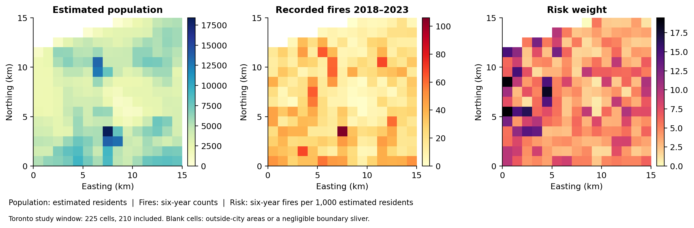

# SYDE 411 Toronto Fire Station Location Optimization

A SYDE 411 course project on the trade-off between opening fewer fire stations and keeping higher-risk areas closer to a station. The Python experiment uses binary NSGA-II to search for layouts in a 15 x 15 km study window in Toronto and an exact set-cover model to find the minimum station count for the same coverage rule.

**Key result.** The smallest layout found by NSGA-II used **8 stations** and placed all 210 demand-cell centres within **3.61 km** of a selected site. The exact benchmark established that **7 stations** are sufficient and necessary to meet the 4 km coverage requirement.



## Run the experiment

Use Python 3.13. The recorded runs used Python 3.13.9, and [requirements.txt](requirements.txt) pins the dependencies. Run these commands from the repository root:

```bash
python3.13 -m venv .venv
source .venv/bin/activate
python -m pip install -r requirements.txt

python verify_results.py
python run_nsga2.py
python verify_results.py
python make_figures.py
```

The first verification checks the committed layouts. Running the optimizer replaces the files in `results/`. The figure script writes three PNGs and `slide_data.json` in the project root.

## Model

The study window contains 225 one-square-kilometre cells. The centres of 210 included cells serve as both demand points and candidate sites for a hypothetical station layout. Each candidate site is represented by a binary open-or-closed decision.

A feasible layout places every demand-cell centre within **4 km of its nearest open station**, measured in a straight line. Among feasible layouts, NSGA-II minimizes two objectives:

1. **Station count.** Count the open sites.
2. **Risk-weighted distance.** Multiply each demand cell’s distance to its nearest station by the cell’s risk weight, then sum across cells.

The risk weight is **1,000 × recorded fires ÷ estimated residents**, using six years of published fire records (2018–2023) and population estimates allocated by area from 2021 neighbourhood profiles. The study window contains 5,007 recorded fires. The coverage rule follows the reference study and applies to cell centres. The model omits road travel, staffing and station capacity.

## Read the results

Each of the five runs (seeds 411-415) used 120 individuals and 200 generations, for 24,000 evaluations per run. Seed 411 found the mapped eight-station layout. The other four runs reached nine stations. The archived pooled front contains 94 nondominated solutions found across the five runs and approximates the trade-off between the two objectives. A fresh run can produce a different pooled front even with the same seeds. The exact set-cover solve establishes the minimum station count for coverage alone.

| File | What it contains |
| --- | --- |
| [Experiment summary](results/experiment_summary.json) | Run settings, per-seed results, selected layout metrics and exact solver status |
| [Pooled front](results/pooled_front.csv) | Station counts and risk-weighted distances for the 94 nondominated solutions |
| [Selected layout](results/selected_layout_225_cells.csv) | All 225 input cells with flags identifying the eight mapped stations |
| [Exact set-cover layout](results/exact_set_cover_layout.csv) | The seven sites selected by the minimum-coverage solve |
| [Saved layouts](results/layouts.npz) | Binary station selections, cell IDs and objective values |
| [Pareto plot](figures/pareto.png) and [convergence plot](figures/convergence.png) | The pooled trade-off and hypervolume by generation and seed |

## Rebuild the input data

Run `python source_snapshot/reproduce.py` with the pinned dependencies to rebuild the grid from the archived source files. The script writes its CSV to `source_snapshot/toronto_225_cells.csv`. The optimizer reads the frozen copy at the repository root. The preprocessing script also generates a preliminary greedy layout for illustration. The eight-station NSGA-II layout is in [results/selected_layout_225_cells.csv](results/selected_layout_225_cells.csv).

Processing rules, assumptions and data fingerprints are recorded in the [source notes](source_snapshot/README.md) and [snapshot summary](source_snapshot/summary.json).

## References

- Yao, Zhang and Murray (2019). [Location optimization of urban fire stations: Access and service coverage](https://doi.org/10.1016/j.compenvurbsys.2018.10.006).
- Deb et al. (2002). [A fast and elitist multiobjective genetic algorithm: NSGA-II](https://doi.org/10.1109/4235.996017). The experiment uses [pymoo’s implementation](https://pymoo.org/algorithms/moo/nsga2.html).
- City of Toronto Open Data, published under the [Open Government Licence – Toronto](https://open.toronto.ca/open-data-license/). [Fire Incidents](https://open.toronto.ca/dataset/fire-incidents/), [Neighbourhood Profiles](https://open.toronto.ca/dataset/neighbourhood-profiles/), [Neighbourhoods](https://open.toronto.ca/dataset/neighbourhoods/), and [Fire Station Locations](https://open.toronto.ca/dataset/fire-station-locations/).

**Authors** — Annie Cai, Michelle Wang, Jacqueline Fung.
